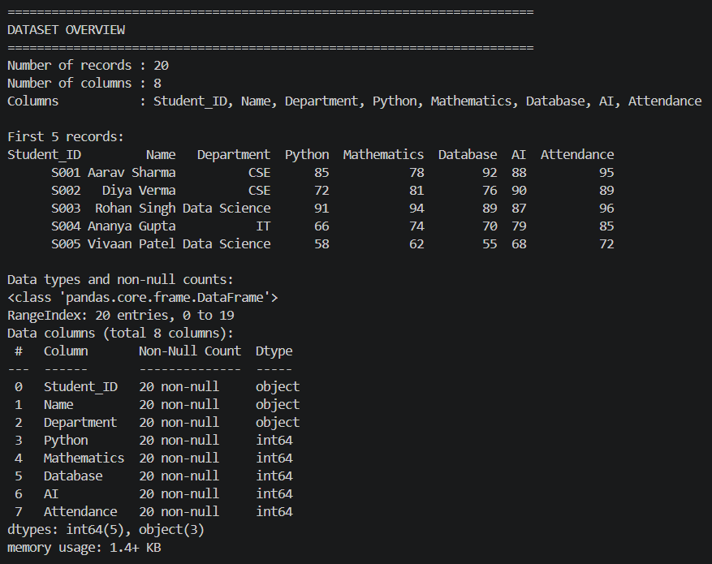
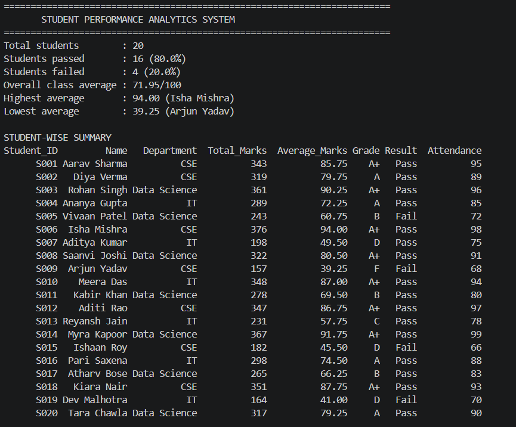
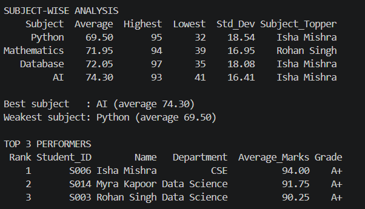
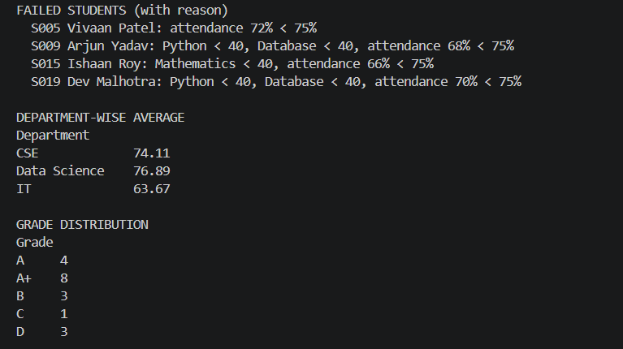

# Project Documentation: Student Performance Analytics System

## 1. Project Title
**Project:** Student Performance Analytics System
**Student Name:** [Sumit Singh]
**Course / Batch:** Python with AI, EWB Courses
**University:** Shri Ramswaroop Memorial University, Lucknow
**Submission Date:** [26/10/2026]

## 2. Objective
Calculating totals, averages, grades and pass/fail results by hand for many students is slow and error-prone. This project automates it: it reads student marks and attendance from a CSV file, analyzes them with Python, NumPy and Pandas, and prints a clear report of student, subject and department performance.

## 3. Technologies Used
- Python 3
- NumPy (numerical calculations)
- Pandas (DataFrame loading, grouping, sorting)
- CSV (dataset storage)
- Git and GitHub (version control and submission)

## 4. Dataset Description
`students.csv` holds **20 fictional student records** with 8 columns:

| Column | Meaning |
|---|---|
| Student_ID | Unique ID (S001–S020) |
| Name | Student name |
| Department | CSE, IT or Data Science |
| Python, Mathematics, Database, AI | Marks out of 100 |
| Attendance | Attendance percentage |

Attendance is used only for the pass/fail rule, not for total or average marks.

## 5. Implementation
1. `main.py` loads `students.csv` with `pd.read_csv()`.
2. It validates the data: file exists, required columns present, no blank or non-numeric values, all values between 0 and 100.
3. `show_data_overview()` prints the record count, columns, first 5 rows and data types.
4. `calculate_total_and_average()` converts the four subject columns to a NumPy array and uses `np.sum` and `np.mean` along `axis=1` for each student.
5. `process_student_records()` loops over every row, calling `assign_grade()` and `assign_result()`.
6. `subject_analysis()` loops over the subjects and uses `np.mean`, `np.max`, `np.min` and `np.std` for each, and finds the subject topper.
7. `get_top_students()` sorts by average and returns the top 3.
8. `print_report()` prints the full analysis, and the processed data is saved to `student_analysis_output.csv`.

**Grading rule:** A+ (average ≥ 80), A (≥ 70), B (≥ 60), C (≥ 50), D (≥ 40), F (< 40).
**Pass rule:** at least 40 in every subject **and** attendance of at least 75%; otherwise Fail.

## 6. Key Features
- `show_data_overview()` – dataset information
- `calculate_total_and_average()` – NumPy-based totals and averages
- `assign_grade()` – grade from average
- `assign_result()` – pass/fail from marks and attendance
- `process_student_records()` – applies all rules in a loop
- `subject_analysis()` – subject average, highest, lowest, std deviation and topper
- `get_top_students()` – ranked top performers
- `print_report()` – readable final report, including reasons for each failure
- Input validation and CSV export of results

## 7. Output / Screenshots
   
   
   
   

## 8. Final Outcome
For the 20-student dataset the system found:
- **16 passed, 4 failed** (80% pass rate)
- Overall class average: **71.95**
- Highest average: **Isha Mishra (94.00)**; lowest: **Arjun Yadav (39.25)**
- Best subject: **AI (74.30)**; weakest: **Python (69.50)**
- Top 3: Isha Mishra, Myra Kapoor, Rohan Singh
- Department averages: Data Science 76.89, CSE 74.11, IT 63.67

The report is readable without opening the code, and the results are saved to a CSV file.

## 9. Challenges and Learning
- Output bug: the headings printed a literal \n because the code used "\\n" instead of "\n". I fixed it and re-ran the program to check the output.
- Pass/fail rule: using only the average could let a student pass with a very low subject mark. I set the rule to at least 40 in every subject and at least 75% attendance.
- NumPy and Pandas: I learned that Pandas handles the DataFrame and NumPy does the numerical calculations (np.sum, np.mean, np.max, np.min, np.std).
- Data validation: I added checks for missing columns, blank values and marks outside 0–100, so wrong data cannot give wrong results.

Learning
- I learned to load CSV data into a DataFrame, write reusable functions, use loops, apply NumPy for numerical work and Pandas for grouping and sorting. I also learned to test the output, fix bugs and document the project.

## 10. GitHub Repository
[https://github.com/singhsumit227/student-performance-analytics]

## How to Run
```bash
python -m pip install -r requirements.txt
python main.py
```
